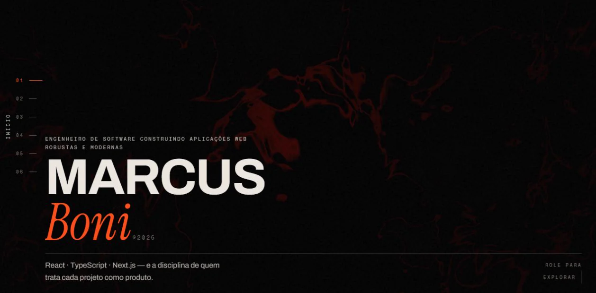
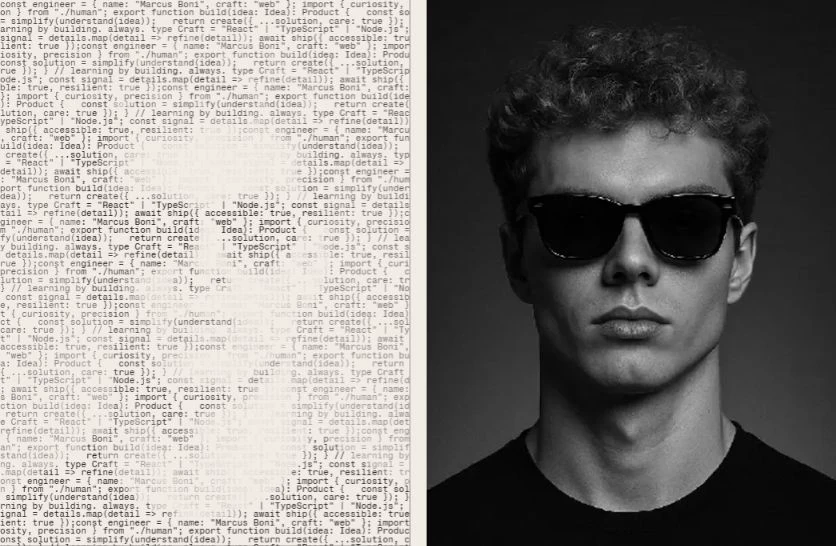

# Marcus Boni

**Portfólio de engenharia de software · Signal & Ink**

Uma seleção do que construo, dos problemas que resolvo e do que aprendo no caminho. O site reúne projetos, experiência profissional e um diário técnico em português e inglês.

**[Explorar o portfólio](https://marcusboni.com.br/)** · [Projetos](https://marcusboni.com.br/#work) · [Diário técnico](https://marcusboni.com.br/blog) · [Kit front-end](https://marcusboni.com.br/kit/front-end) · [Contato](https://marcusboni.com.br/#contact)

<a href="https://marcusboni.com.br/">
  <picture>
    <source media="(prefers-color-scheme: dark)" srcset="./docs/readme/portfolio-dark.webp">
    <source media="(prefers-color-scheme: light)" srcset="./docs/readme/portfolio-light.webp">
    
  </picture>
</a>

## A experiência

Signal & Ink combina tipografia editorial com gráficos desenhados em código. Na abertura, um campo de tinta reage ao movimento. A galeria reúne projetos como **OptTime**, **Estimativa de Horas** e **Opt Gestão**, ao lado de casos que documentam meu trabalho em aplicações web, integrações e ferramentas internas.

Na seção [Sobre](https://marcusboni.com.br/#about), linhas de código formam o retrato e se dissolvem na fotografia. A animação pode ser repetida, acompanha o tema claro ou escuro e respeita a preferência por movimento reduzido.

<p>
  
</p>

## Por trás do site

| Área | Implementação |
| --- | --- |
| **Interface e movimento** | React, TypeScript e Tailwind CSS. GSAP e Lenis coordenam a navegação e as transições. Three.js e Canvas 2D desenham o campo de tinta e o retrato. |
| **Publicação** | O diário usa Markdown e realce com Shiki. Um painel autenticado com Firebase centraliza edição de conteúdo, publicação e mensagens. |
| **Entrega e leitura por máquinas** | Vite gera o site. Netlify Edge Functions entregam o HTML público do diário, os metadados e a API de leitura descrita em OpenAPI. |

[Portal de desenvolvedores](https://marcusboni.com.br/developers) · [OpenAPI](https://marcusboni.com.br/openapi.json) · [RSS do diário](https://marcusboni.com.br/rss.xml)

## Executar localmente

Com Node.js 22.12+ e pnpm, na raiz do repositório:

```bash
pnpm install --frozen-lockfile
pnpm dev
```

A home funciona com os dados locais sem configurar o Firebase. Para validar alterações, execute `pnpm lint`, `pnpm test` e `pnpm build`. O preview do Vite serve os arquivos de build. As rotas e respostas das Edge Functions são verificadas pela suíte de testes e pelo ambiente Netlify.

- [Sistema visual](./DESIGN.md) · identidade, temas, movimento e acessibilidade.
- [Diário técnico](./docs/BLOG.md) · edição, publicação e componentes de conteúdo.
- [Painel editorial](./docs/ADMIN_SETUP.md) · configuração do Firebase e administração.
- [Conteúdo para leitores automatizados](./docs/AGENTS.md) · rotas e formatos públicos.

## Autoria e uso

Este repositório é público para dar visibilidade ao trabalho de Marcus Boni. O portfólio não é distribuído sob licença open source. Para solicitar autorização de uso do código, do design ou dos materiais autorais, entre em contato pelo [site](https://marcusboni.com.br/#contact).
